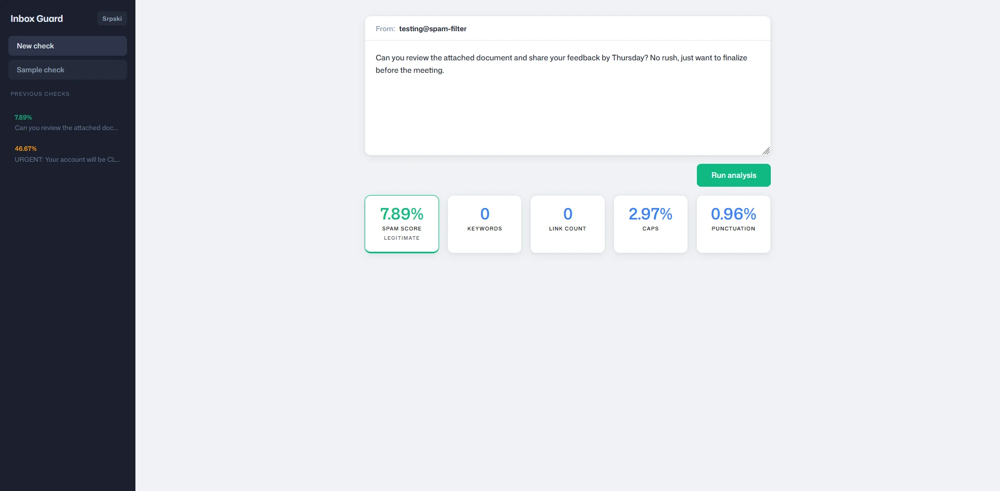

# Fuzzy Guard

**Fuzzy Guard** is a web-based email spam detection system based on **Fuzzy Logic**. Instead of classifying emails strictly as spam or not spam (binary classification), this system calculates the *degree of suspicion* on a scale from 0% to 100% using fuzzy inference.

The application features a responsive web interface with full bilingual support (**English** and **Serbian**).

**Live website:** [dusan86.pythonanywhere.com](https://dusan86.pythonanywhere.com/)

---

## Features

- **Fuzzy Inference System (FIS):** Employs Mamdani fuzzy inference to evaluate multiple email attributes simultaneously.
- **Bilingual Interface:** Real-time translation toggle between English and Serbian.
- **History Tracking:** View and recall previous checks performed during the active session.
- **Sample Loader:** Instantly load random pre-defined test emails to see the system in action.
- **Modern UI:** Sleek dark-mode dashboard styled with CSS.

---

## Screenshots

**Legitimate email, low suspicion score:**



**Spam email, high suspicion score, flagged across all signals:**


---

## How It Works

Traditional spam filters use rigid rules (e.g., "if email contains *FREE*, mark as spam"). The fuzzy approach maps features to **degrees of membership** in fuzzy sets, combines them using rules through Mamdani inference, and defuzzifies the result using the **centroid method** to produce a final score.

### Input Variables (0-10 or 0-100%)
The system extracts and analyzes four input features from the email text:

| Input | Description | Range |
|---|---|---|
| `kljucne_reci` (Keywords) | Count of identified spam keywords/phrases | 0-10 |
| `broj_linkova` (Links) | Total URL links found in the body | 0-10 |
| `caps_procenat` (Caps %) | Percentage of uppercase letters in the text | 0-100% |
| `interpunkcija` (Punctuation) | Density of exclamation marks and question marks | 0-100% |

The defuzzified `spam_score` (0-100%) is then interpreted linguistically: each of the six output sets is evaluated at that score, and the set with the highest membership decides the category — **LEGITIMATE** (LEGITIMAN), **SUSPICIOUS** (SUMNJIVO), or **SPAM** (SPAM). Because the category is derived from the very number that is displayed, the score and the label can never contradict each other.

---

## Technology Stack

- **Backend:** Python 3 (Flask, `scikit-fuzzy`, `numpy`, `scipy`)
- **Frontend:** HTML5, CSS3, Vanilla JavaScript (bilingual localization, interactive state management)

---

## Project Structure

```text
Fuzzy-Guard/
├── fazi/
│   ├── skupovi.py          # Fuzzy set definitions (trapezoidal and triangular membership functions)
│   ├── pravila.py          # Fuzzy rules and fuzzification of inputs
│   ├── zakljucivanje.py    # Main fuzzy inference controller
│   └── defazifikacija.py   # Centroid defuzzification
├── neuronska_mreza/
│   ├── nauci_recnik.py     # learns the spam lexicon and exports JSON
│   └── treniraj.py         # MLP comparison + lexicon ablation
├── podaci/
│   ├── recnik_naucen.json  # learned spam words with weights
│   ├── spamassassin.tsv    # 3,000 labelled emails (500 spam)
│   └── SMSSpamCollection.tsv
├── veb/
│   ├── static/
│   │   ├── fonts/
│   │   │   └── MonaSansVF[wght,opsz].woff2
│   │   ├── izgled.css      # Styling (Dark mode, responsive grid layout)
│   │   ├── engine.js       # Client-side logic: i18n, fetch calls, history rendering
│   │   └── ikona.svg       # Application logo
│   └── sabloni/
│       └── dashboard.html  # Main GUI markup (forms, history panel, results grid)
├── obrada_teksta/
│   └── analizator.py       # Email text analyzer (feature extraction and sample parsing)
├── screenshots/
│   ├── Legit-example.webp  # Legitimate email example screenshot
│   └── Spam-example.png    # Spam email example screenshot
├── tests/
│   └── test_fis.py         # Regression tests for the fuzzy system
├── main.py                 # Flask web application entrypoint & REST API routes
├── requirements.txt        # Python package dependencies
├── primeri.txt             # Pre-configured test emails (separated by '---')
├── run.bat                 # One-click Windows launcher
├── AGENTS.md               # Project conventions (naming, academic constraints)
├── Procfile                # Deployment configuration (web: python main.py)
└── .gitignore
```


## Fuzzy Sets Configuration

The boundaries for membership functions are configured in `fazi/skupovi.py`:

* **Keywords** `[0-10]`
  - `zanemarljive` (Negligible): `trapmf [0, 0, 1, 3]`
  - `zastupljene` (Present): `trimf [1, 3, 7]`
  - `dominantne` (Dominant): `trapmf [5, 8, 10, 10]`

* **Link Count** `[0-10]`
  - `minimalni` (Minimal): `trapmf [0, 0, 0, 1]`
  - `umereni` (Moderate): `trimf [0, 1, 3]`
  - `brojni` (Numerous): `trapmf [2, 8, 10, 10]`

* **Caps Percentage** `[0-100%]`
  - `uobicajen` (Normal): `trapmf [0, 0, 1, 12]`
  - `poviseni` (Elevated): `trimf [7, 16, 32]`
  - `blago_povisen` (Mildly Elevated): `trimf [10, 25, 65]`
  - `agresivan` (Aggressive): `trapmf [45, 85, 100, 100]`

* **Punctuation** `[0-100%]`
  - `retka` (Sparse): `trapmf [0, 0, 2, 5]`
  - `blago` (Mild): `trimf [2, 5, 10]`
  - `umerena` (Moderate): `trimf [6, 12, 25]`
  - `agresivna` (Aggressive): `trapmf [14, 40, 100, 100]`

* **Spam Score (Output)** `[0-100]`
  - `score_legitiman` (Legitimate): `trapmf [0, 0, 8, 20]`
  - `score_legitiman_energicno` (Energetically Legitimate): `trimf [10, 13, 22]`
  - `score_blago_sumnjiv` (Mildly Suspicious): `trimf [24, 30, 42]`
  - `score_sumnjiv` (Suspicious): `trimf [38, 44, 58]`
  - `score_visoko_sumnjiv` (Highly Suspicious): `trimf [54, 60, 74]`
  - `score_spam` (Spam): `trapmf [72, 88, 100, 100]`

All sets are triangular or trapezoidal. Two design rules matter for the scores
to stay informative:

1. **No early saturation.** The right shoulder of a "bad" set sits at the end of
   its universe, so membership keeps growing instead of flattening out at
   `[2, 4, 10, 10]`.
2. **No perfectly symmetric output triangles.** For a symmetric triangle the
   centroid is identical at every activation strength, so the firing strength is
   lost and every email that triggers the same rule gets exactly the same score.

---

## Fuzzy Rules

The rules mapping fuzzy inputs to decisions are set up in `fazi/pravila.py`:

| Rule | Condition | Consequent |
|---|---|---|
| **p01** | `zanemarljive` (negligible) AND `minimalni` (minimal) AND `uobicajen` (normal) AND `retka` (sparse) | **LEGITIMATE** |
| **p02** | `blago` (mildly elevated) caps AND `zanemarljive` (negligible) AND `minimalni` (minimal) links | **LEGITIMATE** |
| **p03** | `blago` (mild) punctuation AND `zanemarljive` (negligible) AND `minimalni` (minimal) links | **LEGITIMATE** |
| **p03a** | `umerena` (moderate) punctuation AND `zanemarljive` (negligible) AND `minimalni` (minimal) links — variant of p03 | **LEGITIMATE** |
| **p04** | `zanemarljive` (negligible) AND `umereni` (moderate) AND `uobicajen` (normal) AND `retka` (sparse) | **MILDLY SUSPICIOUS** |
| **p05** | `zastupljene` (present) AND `minimalni` (minimal) links | **SUSPICIOUS** |
| **p06** | `zastupljene` (present) AND `umereni` (moderate) AND `uobicajen` (normal) AND `retka` (sparse) | **SUSPICIOUS** |
| **p06a** | `zastupljene` (present) AND `umereni` (moderate) links — p06 without the caps/punctuation guards | **SUSPICIOUS** |
| **p07** | (`umereni` OR `brojni`) links AND (`poviseni` OR `blago_povisen` OR `agresivan`) caps AND `zanemarljive` (negligible) keywords | **SUSPICIOUS** |
| **p08** | (`umereni` OR `brojni`) links AND (`umerena` OR `blago` OR `agresivna`) punctuation AND `zanemarljive` (negligible) keywords | **SUSPICIOUS** |
| **p09** | `zastupljene` (present) AND `umereni` (moderate) AND `poviseni` (elevated) AND `umerena` (moderate) | **HIGH SUSPICION** |
| **p10** | `dominantne` (dominant) AND `umereni` (moderate) AND `uobicajen` (normal) AND `retka` (sparse) | **HIGH SUSPICION** |
| **p11** | `dominantne` (dominant) AND `uobicajen` (normal) caps | **HIGH SUSPICION** |
| **p12** | `agresivan` (aggressive) caps AND `zanemarljive` (negligible) AND `minimalni` (minimal) links | **HIGH SUSPICION** |
| **p13** | `agresivna` (aggressive) punctuation AND `zanemarljive` (negligible) AND `minimalni` (minimal) links | **HIGH SUSPICION** |
| **p14** | `dominantne` (dominant) keywords OR `brojni` (numerous) links | **SPAM** |
| **p15** | `zastupljene` (present) AND (`agresivan` (aggressive) caps OR `agresivna` (aggressive) punctuation) | **SPAM** |
| **p16** | `umereni` (moderate) links AND (`agresivan` (aggressive) caps OR `agresivna` (aggressive) punctuation) | **SPAM** |
| **p17** | (`zastupljene` OR `dominantne`) keywords AND (`umereni` OR `brojni`) links AND (`poviseni` OR `blago_povisen` OR `agresivan`) caps | **SPAM** |

Rules are numbered in one continuous run `p01 → p17`. A letter suffix is used
only for a close variant of the rule directly before it (`p03`/`p03a`,
`p06`/`p06a`). `p03a` and `p06a` close coverage holes: without them there were
input combinations where **no rule fired at all** and the score fell back to a
constant. A standalone "dominant keywords → SPAM" rule was removed because
`p14` already covers it through `max(dominantne, brojni)`.


## Installation & Running Locally

1. **Clone the repository:**
```bash
   git clone https://github.com/DusanSl/Fuzzy-Guard
   cd Fuzzy-Guard
```

2. **Set up a virtual environment (optional but recommended):**
```bash
   python -m venv .venv
   # On Windows:
   .venv\Scripts\activate
   # On macOS/Linux:
   source .venv/bin/activate
```

3. **Install dependencies:**
```bash
   pip install -r requirements.txt
```

4. **Run the Flask application:**
```bash
   python main.py
```
   The application will run locally at `http://127.0.0.1:5000`.

---

## API Documentation

### `POST /analiziraj`

Analyzes an email's body text and returns the computed fuzzy attributes and classifications.

**Request Body (JSON):**
```json
{
  "tekst": "CONGRATULATIONS! You WON a FREE prize! Click http://fakesite.com NOW!" // Text
}
```

**Response (JSON):**
```json
{
  "tekst": "CONGRATULATIONS! You WON a FREE prize! Click http://fakesite.com NOW!", // Text
  "kljucne_reci": 7,       // Keywords
  "broj_linkova": 1,       // Link count
  "caps_procenat": 50.00,  // Caps percentage
  "interpunkcija": 7.14,   // Punctuation
  "spam_score": 88.46,     // Spam score
  "kategorija": "SPAM"     // Category
}
```

### `GET /primer`

Returns a random pre-configured email string from `primeri.txt`.

**Response (JSON):**
```json
{
  "tekst": "Hi, just wanted to confirm our meeting tomorrow at 3pm..." // Text
}
```

---

## Neural Network Component

The course also covers neural networks, so the project includes a neural part in
`neuronska_mreza/`. The network does **not** compute `spam_score` — the fuzzy
system stays the only decision maker. Instead the network **learns the spam
lexicon**: it discovers which words and phrases are characteristic of spam and
exports them with weights.

```text
labelled emails → TF-IDF (1–2 grams) → single-neuron classifier
                → coefficients → podaci/recnik_naucen.json
```

At runtime those weights feed the first fuzzy input, `kljucne_reci`, exactly as
the hand-written list does:

```text
kljucne_reci = hand-dictionary hits (weight 1.0)
             + learned-lexicon hits (learned weight)
             → normalised to 0–10 → Mamdani FIS (unchanged)
```

Terms are only kept if they appear in at least 10 spam emails and are **at least
3× more frequent in spam than in ham**, which filters out generic words like
"information" and "contact". HTML/MIME artifacts ("font", "href", "nbsp") are
rejected explicitly.

```
python -m neuronska_mreza.nauci_recnik      # learn + export the lexicon
python -m neuronska_mreza.treniraj          # compare models
```

### The Serbian dictionary is the "without NN" baseline

The hand-written dictionary in `obrada_teksta/analizator.py` — including the full
Serbian list — is **never removed**. The training corpora are English-only, so
the network cannot learn a single Serbian word; the hand dictionary is the only
Serbian coverage and the baseline that shows how the project behaves **without**
a neural network.

Three modes are therefore kept runnable at all times:

| Mode | Meaning | Serbian coverage |
|---|---|---|
| `rucni` | hand dictionary only — **no neural network** | full |
| `nauceni` | learned lexicon only | none (English corpus) |
| `kombinovano` | both (default) | full |

Use `FUZZY_GUARD_RECNIK=rucni python main.py` to run the app with the NN-free
baseline. The ablation below is produced with
`python -m neuronska_mreza.treniraj --recnik svi`.

### Results (held-out test set)

Corpus: **SpamAssassin** (3,000 emails, 500 spam), 750 test emails, 125 spam.

| Model | Lexicon | Accuracy | Precision | Recall | F1 |
|---|---|---|---|---|---|
| Neural network (MLP) | `rucni` | 0.929 | 0.883 | 0.664 | 0.758 |
| Fuzzy system (Mamdani) | `rucni` | 0.771 | 0.382 | 0.608 | 0.469 |
| Neural network (MLP) | `nauceni` | 0.956 | 0.942 | 0.784 | 0.856 |
| Fuzzy system (Mamdani) | `nauceni` | 0.791 | 0.424 | 0.712 | 0.531 |
| Neural network (MLP) | `kombinovano` | 0.957 | 0.904 | 0.832 | 0.867 |
| Fuzzy system (Mamdani) | `kombinovano` | 0.792 | 0.432 | 0.784 | **0.557** |

The learned lexicon raises the fuzzy system's F1 from **0.469 to 0.557** and its
recall from **0.608 to 0.784**, without changing the rule base or the fuzzy
inference. The network therefore has a measurable job: it supplies better
evidence, while the fuzzy rules still make the decision.

The fuzzy system trades precision for interpretability: every score can be
traced back to a membership function and a rule. On the **SMS Spam Collection**
(5,574 messages) the fuzzy system collapses to 3% spam recall with the hand
dictionary, because its features are calibrated for email — SMS messages have
almost no capitalisation or links. That domain sensitivity is a documented
limitation, not a bug.

Dataset sources:

- SpamAssassin public corpus: <https://spamassassin.apache.org/old/publiccorpus/>
- UCI SMS Spam Collection: <https://archive.ics.uci.edu/dataset/228/sms+spam+collection>

---

## Validation and Limitations

- The membership-function boundaries were calibrated on a small set of sample
  emails (`primeri.txt`). All reported model metrics come from held-out test
  data, never from the tuning set.
- `primeri.txt` is **not labelled**: its `[EN]` / `[SR]` tags mark the language,
  not the class. The sample set is a demo, not a benchmark.
- Different emails can still produce the same `spam_score`. That is inherent to
  Mamdani inference: if two inputs have the same membership in every set and
  activate the same rules with the same strength, the defuzzified output is
  identical by definition.
- Serbian is covered by the rule base / keyword dictionary only; the trained
  network is English-only.

---

## Development

```bash
python -m pytest
```

The test suite checks rule-base completeness (no input may leave every rule at
zero), score/category agreement, the 35–45% caps regression, and that obvious
spam and legitimate emails land in the expected categories.

Project conventions for contributors and AI agents are in [`AGENTS.md`](AGENTS.md).

---

## License

[](http://creativecommons.org/licenses/by-nc-sa/4.0/)

This work is licensed under a [Creative Commons Attribution-NonCommercial-ShareAlike 4.0 International License](http://creativecommons.org/licenses/by-nc-sa/4.0/).

Full license: [LICENSE](LICENSE.txt) | [CC BY-NC-SA 4.0](https://creativecommons.org/licenses/by-nc-sa/4.0/)

**What this means:**

- **Share:** You can view and fork this repository
- **Adapt:** You can modify the code for educational purposes
- **Attribution:** You must give appropriate credit and link to this repository
- **NonCommercial:** You may not use this work for commercial purposes without permission
- **ShareAlike:** Modified versions must use the same license

**Copyright © 2026 Dušan Slankamenac**

For commercial licensing inquiries: dusanslankamenac8@gmail.com