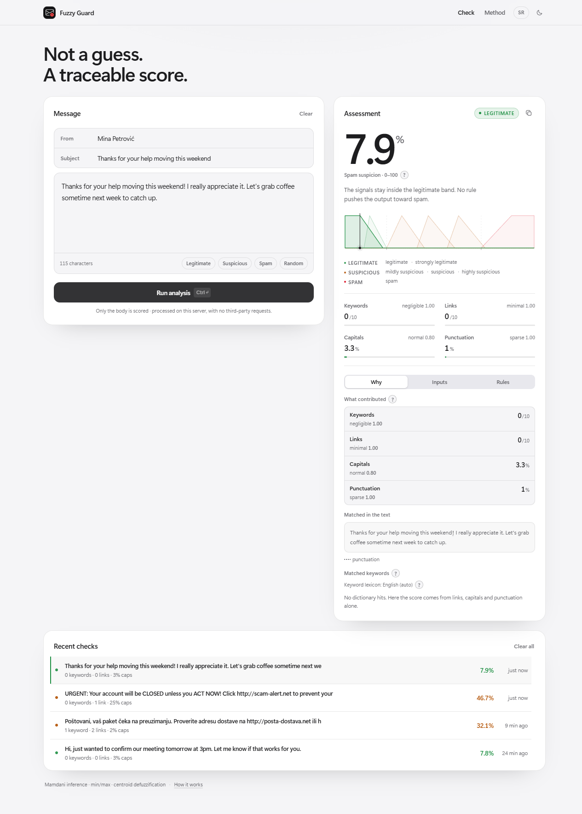
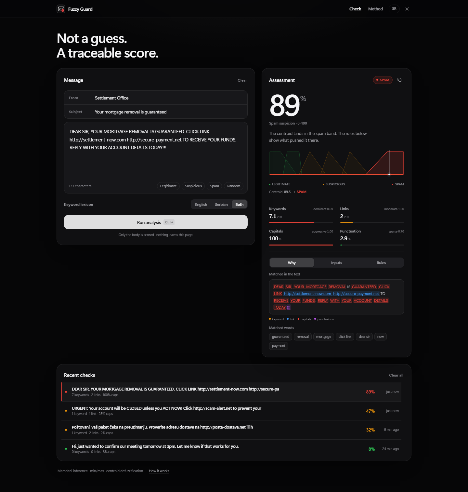

# Fuzzy Guard

**Fuzzy Guard** is a web-based email spam detection system based on **Fuzzy Logic**. Instead of classifying emails strictly as spam or not spam (binary classification), this system calculates the *degree of suspicion* on a scale from 0% to 100% using fuzzy inference.

The application features a responsive web interface with full bilingual support (**English** and **Serbian**).

**Live website:** [dusan86.pythonanywhere.com](https://dusan86.pythonanywhere.com/)

---

## Features

- **Fuzzy Inference System (FIS):** Employs Mamdani fuzzy inference to evaluate multiple email attributes simultaneously.
- **Learned lexicons:** an English and a Serbian keyword lexicon are learned by a one-neuron TF-IDF classifier; the network never computes the score itself.
- **Bilingual Interface:** Real-time translation toggle between English and Serbian.
- **History Tracking:** View and recall previous checks performed during the active session.
- **Sample Loader:** Load a legitimate, suspicious or spam example (English or Serbian) at random, or pick a random example across all categories.
- **Explainable verdict:** a fuzzy spectrum drawn from the actual output sets, plus **Why / Inputs / Rules** tabs showing matched words in context, membership degrees and the rules that fired. Matches are colour-coded (keywords, links, capitals, punctuation).
- **Modern UI:** clean, Apple-inspired layout with a sticky top bar. Dark by default with a light theme; bilingual, responsive and keyboard-friendly.
- **Method dialog:** a short walkthrough of the pipeline (extract → fuzzify → infer → defuzzify) with the output spectrum.

---

## Screenshots

**Legitimate email, low suspicion score:**



**Spam email, high suspicion score, flagged across all signals:**



---

## How It Works

Traditional spam filters use rigid rules (e.g., "if email contains *FREE*, mark as spam"). The fuzzy approach maps features to **degrees of membership** in fuzzy sets, combines them using rules through Mamdani inference, and defuzzifies the result using the **centroid method** to produce a final score.

### Input Variables (0-10 or 0-100%)
The system extracts and analyzes four input features from the email text:

| Input | Description | Range |
|---|---|---|
| `kljucne_reci` (Keywords) | Weighted matches from the learned English/Serbian lexicons, capped at 10 | 0-10 |
| `broj_linkova` (Links) | Total URL links found in the body | 0-10 |
| `caps_procenat` (Caps %) | Percentage of uppercase letters in the text | 0-100% |
| `interpunkcija` (Punctuation) | Density of exclamation marks and question marks | 0-100% |

Keyword matches are **non-overlapping**: the longest phrase wins, so `"free prize"` counts once with its phrase weight instead of also counting `free` and `prize` separately. Match positions are tracked on the original text, so the highlighted preview is exact even for characters whose lowercase form changes length.

The defuzzified `spam_score` (0-100%) is then interpreted linguistically: each of the six output sets is evaluated at that score, and the set with the highest membership decides the category — **LEGITIMATE** (LEGITIMAN), **SUSPICIOUS** (SUMNJIVO), or **SPAM** (SPAM). Because the category is derived from the very number that is displayed, the score and the label can never contradict each other.

---

## Technology Stack

- **Backend:** Python 3 (Flask, `scikit-fuzzy`, `numpy`, `scipy`, `waitress`)
- **Frontend:** HTML5, CSS3, Vanilla JavaScript (bilingual localization, interactive state management)

---

## Project Structure

```text
Fuzzy-Guard/
├── fazi/
│   ├── skupovi.py          # Fuzzy set definitions (trapezoidal and triangular membership functions)
│   ├── pravila.py          # Fuzzy rules and fuzzification of inputs
│   ├── zakljucivanje.py    # Main fuzzy inference controller
│   └── defazifikacija.py   # Centroid defuzzification
├── neuronska_mreza/
│   ├── nauci_recnik.py     # learns the EN/SR spam lexicon and exports JSON
│   ├── izgradi_sr_korpus.py# builds the Serbian corpus by machine translation
│   ├── legacy_recnik.py    # old hand dictionary, evaluation only
│   └── treniraj.py         # MLP comparison + lexicon ablation
├── podaci/
│   ├── recnik_naucen_en.json  # learned English spam words with weights
│   ├── recnik_naucen_sr.json  # learned Serbian spam words with weights
│   ├── spamassassin.tsv       # 3,000 labelled emails (500 spam)
│   ├── sr_spamassassin.tsv    # Serbian corpus (MT + synthetic spam fallback)
│   └── SMSSpamCollection.tsv
├── veb/
│   ├── static/
│   │   ├── fonts/
│   │   │   └── MonaSansVF[wght,opsz].woff2
│   │   ├── izgled.css      # Styling (Dark mode, responsive grid layout)
│   │   ├── engine.js       # Client-side logic: i18n, fetch calls, history rendering
│   │   └── ikona.svg       # Application logo
│   └── sabloni/
│       └── dashboard.html  # Main GUI markup (forms, history panel, results grid)
├── obrada_teksta/
│   ├── analizator.py       # Email text analyzer (features, lexicon loading, samples)
│   └── podudaranje.py      # Tokenizer, offset map and non-overlapping matcher
├── screenshots/
│   ├── Legit-example.png  # Legitimate email example screenshot
│   └── Spam-example.png    # Spam email example screenshot
├── tests/
│   └── test_fis.py         # Regression tests for the fuzzy system
├── main.py                 # Flask web application entrypoint & REST API routes
├── requirements.txt        # Python package dependencies
├── primeri.txt             # Pre-configured test emails (separated by '---')
├── run.bat                 # One-click Windows launcher
├── AGENTS.md               # Project conventions (naming, academic constraints)
├── Procfile                # Deployment configuration (web: waitress-serve ... main:app)
└── .gitignore
```


## Fuzzy Sets Configuration

The boundaries for membership functions are configured in `fazi/skupovi.py`:

* **Keywords** `[0-10]`
  - `zanemarljive` (Negligible): `trapmf [0, 0, 1, 3]`
  - `zastupljene` (Present): `trimf [1, 3, 7]`
  - `dominantne` (Dominant): `trapmf [5, 8, 10, 10]`

* **Link Count** `[0-10]`
  - `minimalni` (Minimal): `trapmf [0, 0, 0, 1]`
  - `umereni` (Moderate): `trapmf [0, 1, 3, 5]`
  - `brojni` (Numerous): `trapmf [3, 8, 10, 10]`

* **Caps Percentage** `[0-100%]`
  - `uobicajen` (Normal): `trapmf [0, 0, 1, 12]`
  - `poviseni` (Elevated): `trimf [7, 16, 32]`
  - `blago_povisen` (Mildly Elevated): `trimf [10, 25, 65]`
  - `agresivan` (Aggressive): `trapmf [45, 85, 100, 100]`

* **Punctuation** `[0-100%]`
  - `retka` (Sparse): `trapmf [0, 0, 2, 5]`
  - `blago` (Mild): `trimf [2, 5, 10]`
  - `umerena` (Moderate): `trimf [6, 12, 25]`
  - `agresivna` (Aggressive): `trapmf [14, 40, 100, 100]`

* **Spam Score (Output)** `[0-100]`
  - `score_legitiman` (Legitimate): `trapmf [0, 0, 8, 20]`
  - `score_legitiman_energicno` (Energetically Legitimate): `trimf [10, 13, 22]`
  - `score_blago_sumnjiv` (Mildly Suspicious): `trimf [22, 30, 42]`
  - `score_sumnjiv` (Suspicious): `trimf [38, 44, 58]`
  - `score_visoko_sumnjiv` (Highly Suspicious): `trimf [54, 60, 74]`
  - `score_spam` (Spam): `trapmf [72, 88, 100, 100]`

All sets are triangular or trapezoidal. Two design rules matter for the scores
to stay informative:

1. **No early saturation.** The right shoulder of a "bad" set sits at the end of
   its universe, so membership keeps growing instead of flattening out at
   `[2, 4, 10, 10]`.
2. **No perfectly symmetric output triangles.** For a symmetric triangle the
   centroid is identical at every activation strength, so the firing strength is
   lost and every email that triggers the same rule gets exactly the same score.
3. **Continuous output coverage.** Adjacent output sets overlap so scores from
   0 to 100 have a non-zero membership. `blago_sumnjiv` starts at 22, so the old
   dead band 22–24 is covered; exactly 22 is the shared boundary and the
   controller falls back to `SUMNJIVO` there.

---

## Fuzzy Rules

The rules mapping fuzzy inputs to decisions are set up in `fazi/pravila.py`:

| Rule | Condition | Consequent |
|---|---|---|
| **p01** | `zanemarljive` (negligible) AND `minimalni` (minimal) AND `uobicajen` (normal) AND `retka` (sparse) | **LEGITIMATE** |
| **p02** | `blago` (mildly elevated) caps AND `zanemarljive` (negligible) AND `minimalni` (minimal) links | **LEGITIMATE** |
| **p03** | `blago` (mild) punctuation AND `zanemarljive` (negligible) AND `minimalni` (minimal) links | **LEGITIMATE** |
| **p03a** | `umerena` (moderate) punctuation AND `zanemarljive` (negligible) AND `minimalni` (minimal) links — variant of p03 | **LEGITIMATE** |
| **p04** | `zanemarljive` (negligible) AND `umereni` (moderate) AND `uobicajen` (normal) AND `retka` (sparse) | **MILDLY SUSPICIOUS** |
| **p05** | `zastupljene` (present) AND `minimalni` (minimal) links | **SUSPICIOUS** |
| **p06** | `zastupljene` (present) AND `umereni` (moderate) AND `uobicajen` (normal) AND `retka` (sparse) | **SUSPICIOUS** |
| **p06a** | `zastupljene` (present) AND `umereni` (moderate) links — p06 without the caps/punctuation guards | **SUSPICIOUS** |
| **p07** | (`umereni` OR `brojni`) links AND (`poviseni` OR `blago_povisen` OR `agresivan`) caps AND `zanemarljive` (negligible) keywords | **SUSPICIOUS** |
| **p08** | (`umereni` OR `brojni`) links AND (`umerena` OR `blago` OR `agresivna`) punctuation AND `zanemarljive` (negligible) keywords | **SUSPICIOUS** |
| **p09** | `zastupljene` (present) AND `umereni` (moderate) AND `poviseni` (elevated) AND `umerena` (moderate) | **HIGH SUSPICION** |
| **p10** | `dominantne` (dominant) AND `umereni` (moderate) AND `uobicajen` (normal) AND `retka` (sparse) | **HIGH SUSPICION** |
| **p11** | `dominantne` (dominant) AND `uobicajen` (normal) caps | **HIGH SUSPICION** |
| **p12** | `agresivan` (aggressive) caps AND `zanemarljive` (negligible) AND `minimalni` (minimal) links | **HIGH SUSPICION** |
| **p13** | `agresivna` (aggressive) punctuation AND `zanemarljive` (negligible) AND `minimalni` (minimal) links | **HIGH SUSPICION** |
| **p14** | `dominantne` (dominant) keywords OR `brojni` (numerous) links | **SPAM** |
| **p15** | `zastupljene` (present) AND (`agresivan` (aggressive) caps OR `agresivna` (aggressive) punctuation) | **SPAM** |
| **p16** | `umereni` (moderate) links AND (`agresivan` (aggressive) caps OR `agresivna` (aggressive) punctuation) | **SPAM** |
| **p17** | (`zastupljene` OR `dominantne`) keywords AND (`umereni` OR `brojni`) links AND (`poviseni` OR `blago_povisen` OR `agresivan`) caps | **SPAM** |

Rules are numbered in one continuous run `p01 → p17`. A letter suffix is used
only for a close variant of the rule directly before it (`p03`/`p03a`,
`p06`/`p06a`). `p03a` and `p06a` close coverage holes: without them there were
input combinations where **no rule fired at all** and the score fell back to a
constant. A standalone "dominant keywords → SPAM" rule was removed because
`p14` already covers it through `max(dominantne, brojni)`.


## Installation & Running Locally

1. **Clone the repository:**
```bash
   git clone https://github.com/DusanSl/Fuzzy-Guard
   cd Fuzzy-Guard
```

2. **Set up a virtual environment (optional but recommended):**
```bash
   python -m venv .venv
   # On Windows:
   .venv\Scripts\activate
   # On macOS/Linux:
   source .venv/bin/activate
```

3. **Install dependencies:**
```bash
   pip install -r requirements.txt
```

4. **Run the Flask application:**
```bash
   python main.py
```
   The application will run locally at `http://127.0.0.1:5000`.

---

## API Documentation

### `POST /analiziraj`

Analyzes an email's body text and returns the computed fuzzy attributes and classifications.

**Request Body (JSON):**
```json
{
  "tekst": "DEAR SIR, YOUR MORTGAGE SETTLEMENT IS GUARANTEED! CLICK LINK http://a.com http://b.com http://c.com NOW!!!",
  "recnik": "kombinovano"   // optional: en | sr | kombinovano
}
```

**Response (JSON):**
```json
{
  "tekst": "DEAR SIR, YOUR MORTGAGE SETTLEMENT IS GUARANTEED! ...",
  "skraceno": false,       // true if the body exceeded the analysis cap
  "kljucne_reci": 6.61,    // Weighted lexicon matches
  "broj_linkova": 3,       // Link count
  "caps_procenat": 100.0,  // Caps percentage
  "interpunkcija": 6.9,    // Punctuation
  "spam_score": 86.0,      // Spam score
  "kategorija": "SPAM",    // Category
  "objasnjenje": {
    "tekst": "...",        // cleaned visible text
    "pokrivene_reci": [    // matched keywords + positions
      { "rec": "dear sir", "broj": 1, "tezina": 1.5267, "izvor": "en", "pozicije": [[0, 8]] }
    ],
    "oznake": [            // links / CAPS / punctuation positions
      { "tip": "link", "pozicije": [[45, 66]] }
    ],
    "aktivna_pravila": [   // strongest fired rules
      { "pravilo": "p14", "jacina": 0.667, "kategorija": "SPAM" }
    ],
    "ulazi": {             // values + membership degrees
      "kljucne_reci": { "vrednost": 7.0, "pripadnosti": { "dominantne": 0.667 } }
    }
  }
}
```

### `GET /primeri-svi?jezik=en|sr`

Returns the sample emails for the given language, including `From`, `Subject` and `Category` metadata.

### `GET /skupovi`

Returns all input and output membership functions. The UI builds its spectrum
from this endpoint, so the curves can never drift from the backend.

```json
{
  "univerzum": { "min": 0, "max": 100, "korak": 1 },
  "ulazi": {
    "kljucne_reci": [
      { "ime": "kljucne_zanemarljive", "naziv": "zanemarljive", "tip": "trapmf",
        "params": [0, 0, 1, 3], "kategorija": "LEGITIMAN" }
    ]
  },
  "izlazi": [
    { "ime": "legitiman", "naziv": "legitiman", "tip": "trapmf",
      "params": [0, 0, 8, 20], "kategorija": "LEGITIMAN" }
  ],
  "skupovi": [ /* same as izlazi, kept for old clients */ ]
}
```

---

## Neural Network Component

The course covers neural networks, so the project includes a neural part in
`neuronska_mreza/`. The network does **not** compute `spam_score` — the fuzzy
system stays the only decision maker. Instead the network **learns the spam
lexicons**: it discovers which words and phrases are characteristic of spam and
exports them with weights.

```text
labelled emails → TF-IDF (1-2 grams) → single-neuron classifier
                → coefficients → podaci/recnik_naucen_en.json
                               → podaci/recnik_naucen_sr.json
```

At runtime those weights feed the first fuzzy input, `kljucne_reci`, exactly as
any other evidence would:

```text
kljucne_reci = non-overlapping lexicon hits (learned weight per term)
             → normalised to 0-10 → Mamdani FIS (unchanged)
```

Terms are only kept if they appear in at least 10 spam emails and are **at least
2x more frequent in spam than in ham**, which filters out generic words. HTML
and MIME artifacts ("font", "href", "nbsp") are rejected explicitly.

```
python -m neuronska_mreza.izgradi_sr_korpus   # MT corpus (resumable, cached)
python -m neuronska_mreza.nauci_recnik --jezik en
python -m neuronska_mreza.nauci_recnik --jezik sr
python -m neuronska_mreza.treniraj            # compare models
```

### The two learned lexicons

The old hand-written dictionary has been removed from the runtime. It survives
only in `neuronska_mreza/legacy_recnik.py` so the "pre / post network" ablation
can be reproduced; the application never imports it.

| Mode | Meaning | Coverage |
|---|---|---|
| `en` | learned English lexicon only | English |
| `sr` | learned Serbian lexicon only | Serbian |
| `kombinovano` | both (default) | both |
| `legacy` | old hand dictionary — **evaluation only** | legacy baseline |

The Serbian lexicon is trained on `podaci/sr_spamassassin.tsv`. The free
translation endpoint rate-limited the run, so the committed corpus is a hybrid:
**1,491 real ham + 13 real spam** emails machine-translated to Serbian and
transliterated to Latin script, plus **600 synthetic Serbian spam templates**
(`--sinteticki-spam`) to keep the positive class usable. Labels are inherited
from the source email; the split is done on the source index, so a translated
email cannot leak between train and test.

This is **not a real Serbian benchmark**. The synthetic spam makes the Serbian
metrics look optimistic; they show that the pipeline learns Serbian vocabulary,
not production accuracy. Re-run `izgradi_sr_korpus.py` with a translation API
key (or after the free limit resets) to replace the synthetic part with real
translations. Serbian evaluation on the hand-labelled examples in `primeri.txt`
is reported separately and is small.

### Results (held-out test set)

Corpus: **SpamAssassin** (3,000 emails, 500 spam), 750 test emails, 125 spam.

| Model | Lexicon | Accuracy | Precision | Recall | F1 |
|---|---|---|---|---|---|
| Neural network (MLP) | `legacy` | 0.897 | 0.853 | 0.464 | 0.601 |
| Fuzzy system (Mamdani) | `legacy` | 0.868 | 0.655 | 0.440 | 0.526 |
| Neural network (MLP) | `en` | 0.935 | 0.932 | 0.656 | 0.770 |
| Fuzzy system (Mamdani) | `en` | 0.903 | 0.724 | 0.672 | 0.697 |
| Neural network (MLP) | `sr` | 0.892 | 0.824 | 0.448 | 0.580 |
| Fuzzy system (Mamdani) | `sr` | 0.849 | 0.607 | 0.272 | 0.376 |
| Neural network (MLP) | `kombinovano` | 0.929 | 0.974 | 0.592 | 0.736 |
| Fuzzy system (Mamdani) | `kombinovano` | 0.900 | 0.695 | 0.712 | 0.704 |

The learned lexicons raise the fuzzy system's F1 from **0.526** to **0.697**
with the English lexicon and to **0.704** with both, while recall rises from
**0.440** to **0.672** and **0.712** respectively, without changing the rule
base or the fuzzy inference. The Serbian lexicon is weaker on English text (as
expected) and exists to cover Serbian input.

The fuzzy system trades precision for interpretability: every score can be
traced back to a membership function and a rule. On the **SMS Spam Collection**
(5,574 messages) the fuzzy system effectively collapses with the learned
lexicons, because its four features are calibrated for email — SMS messages have
almost no capitalisation or links:

| Model | Lexicon | Accuracy | Precision | Recall | F1 |
|---|---|---|---|---|---|
| Fuzzy system (Mamdani) | `legacy` | 0.867 | 1.000 | 0.011 | 0.021 |
| Fuzzy system (Mamdani) | `en` | 0.866 | 0.000 | 0.000 | 0.000 |
| Fuzzy system (Mamdani) | `sr` | 0.866 | 0.000 | 0.000 | 0.000 |
| Neural network (MLP) | `en` | 0.905 | 0.814 | 0.374 | 0.513 |

This is a documented limitation, not a bug: the lexicon is domain-specific and
the fuzzy inputs are email-shaped. A real Serbian SMS corpus and SMS-specific
features would be needed.

### Serbian corpus (held-out, hybrid)

Corpus: `sr_spamassassin.tsv`, 2,104 rows (613 spam, 600 of them synthetic), 526
test rows, 153 spam. These numbers are optimistic because of the synthetic
component:

| Model | Lexicon | Accuracy | Precision | Recall | F1 |
|---|---|---|---|---|---|
| Neural network (MLP) | `sr` | 0.994 | 1.000 | 0.980 | 0.990 |
| Fuzzy system (Mamdani) | `sr` | 0.975 | 0.927 | 0.993 | 0.959 |
| Fuzzy system (Mamdani) | `kombinovano` | 0.975 | 0.927 | 0.993 | 0.959 |

On the real hand-labelled `primeri.txt` spam examples (4 Serbian, 4 English) the
fuzzy system catches all of them, but the sample is far too small to be a
benchmark.

Dataset sources:

- SpamAssassin public corpus: <https://spamassassin.apache.org/old/publiccorpus/>
- UCI SMS Spam Collection: <https://archive.ics.uci.edu/dataset/228/sms+spam+collection>

---

## Validation and Limitations

- The membership-function boundaries were calibrated on a small set of sample
  emails (`primeri.txt`). All reported model metrics come from held-out test
  data, never from the tuning set.
- `primeri.txt` carries `From:`, `Subject:` and `Category:` metadata. Categories
  were auto-assigned by the filter and then **manually corrected for obvious
  misclassifications**; they are not a benchmark.
- Different emails can still produce the same `spam_score`. That is inherent to
  Mamdani inference: if two inputs have the same membership in every set and
  activate the same rules with the same strength, the defuzzified output is
  identical by definition.
- Serbian coverage comes from a **hybrid machine-translated + synthetic** corpus,
  not a real Serbian benchmark. Translation preserves labels but not formatting,
  and the synthetic spam inflates the Serbian metrics.
- SMS recall is near zero because the four features are email-shaped. This is
  documented rather than hidden; a real SMS model would need SMS features.
- The manual dictionary was removed because generic words ("account", "update",
  "confirm") caused false positives. The old list remains only as the `legacy`
  evaluation baseline.
- Bodies are capped at 50,000 characters and requests at 256 KB. The response
  sets `skraceno: true` when truncation happened.

---

## Development

```bash
python -m pytest
```

The test suite checks rule-base completeness (no input may leave every rule at
zero), output-universe coverage, score/category agreement, non-overlapping
keyword matches, Unicode offsets, the caps regression, and that obvious spam and
legitimate emails land in the expected categories.

A browser smoke test is available separately (it needs a running server):

```bash
pip install -r requirements-dev.txt
playwright install chromium
python main.py            # in another terminal
python tests/smoke_ui.py
```

### Continuous integration

`.github/workflows/tests.yml` runs `pytest` on every push to `master` / `razvoj`
and on every pull request. It does **not** deploy: PythonAnywhere still needs

```bash
cd ~/fuzzy-guard && git pull
```

followed by **Reload** on the Web tab.

### Docker (optional)

Not used in production — PythonAnywhere runs the app via WSGI. The Dockerfile
exists so the exact environment can be reproduced anywhere:

```bash
docker build -t fuzzy-guard .
docker run -p 5000:5000 fuzzy-guard
```

The two learned lexicons (`podaci/recnik_naucen_en.json` and
`podaci/recnik_naucen_sr.json`) are copied into the image, so the container runs
with the full `kombinovano` setup.

Project conventions for AI agents are kept locally in `AGENTS.md` (not published).

---

## License

[](http://creativecommons.org/licenses/by-nc-sa/4.0/)

This work is licensed under a [Creative Commons Attribution-NonCommercial-ShareAlike 4.0 International License](http://creativecommons.org/licenses/by-nc-sa/4.0/).

Full license: [LICENSE](LICENSE.txt) | [CC BY-NC-SA 4.0](https://creativecommons.org/licenses/by-nc-sa/4.0/)

**What this means:**

- **Share:** You can view and fork this repository
- **Adapt:** You can modify the code for educational purposes
- **Attribution:** You must give appropriate credit and link to this repository
- **NonCommercial:** You may not use this work for commercial purposes without permission
- **ShareAlike:** Modified versions must use the same license

**Copyright © 2026 Dušan Slankamenac**

For commercial licensing inquiries: dusanslankamenac8@gmail.com